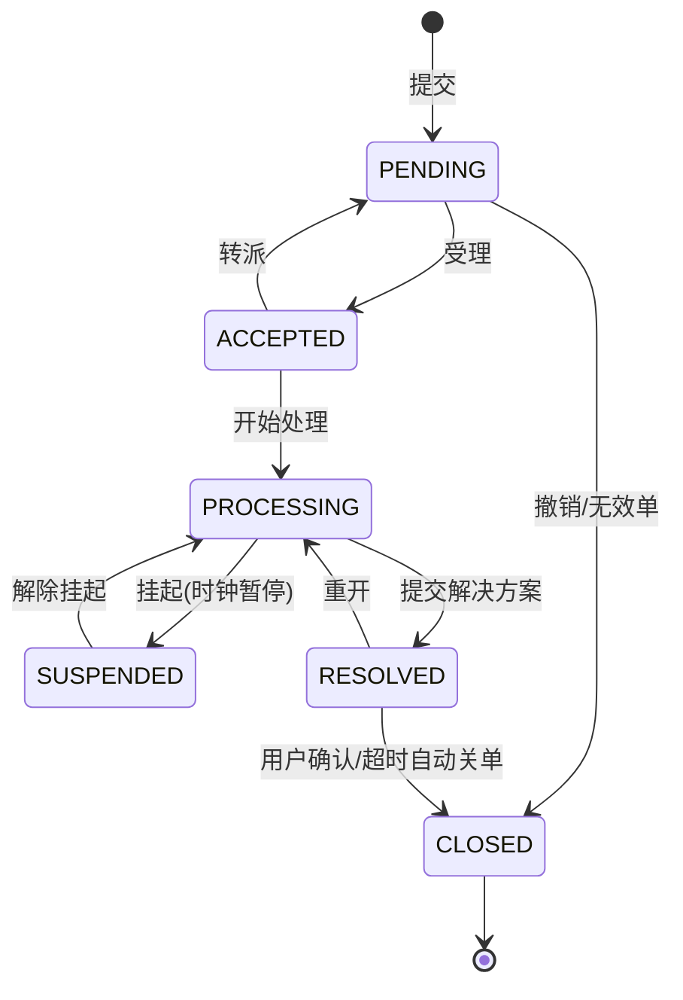

# ITSM 产品设计文档(精简版)

| 项目 | 内容 |
|------|------|
| 产品名称 | ITSM 一体化 IT 服务管理平台(暂定名) |
| 文档版本 | v0.1(精简版) |
| 编制日期 | 2026-10-04 |
| 定位说明 | 本文为**轻量交付版**设计:平台底座(用户/角色/权限)+ 基础 ITIL 四流程;低代码设计器、全渠道接入、AI 等完整能力见《产品设计文档.md》 |
| 技术基线 | Spring Boot 3 + Flowable + MyBatis-Plus + PostgreSQL + Redis / Vue3 + Element Plus |

---

## 1. 产品定位

面向中大型企业 IT 部门的**轻量级、可私有化部署**的 IT 服务管理平台:开箱即用、最小依赖即可运行(仅需 PostgreSQL + Redis),覆盖 ITIL 核心服务管理场景的基础闭环。

```
用户报障/提请求 → 统一受理 → 分派处理 → (问题/变更协同) → 解决关单 → 度量
```

## 2. 用户角色

| 角色 | 典型用户 | 核心操作 |
|------|---------|---------|
| 员工(提单者) | 全员 | 提交事件/请求、查看进度、确认关闭、评价 |
| 服务台坐席 | IT Help Desk | 统一受理、分派、催办、关闭无效单 |
| 处理组工程师 | 运维/网络/桌面 | 受理、处理、转派、提交解决方案 |
| 变更经理 | IT 流程经理 | 变更评估、审批组织、日历查看 |
| 系统管理员 | 平台运维 | 用户/部门/角色/字典管理、审计查看 |
| 管理者 | IT 经理 | 看板与报表(只读) |

> 权限模型:RBAC。角色绑定「菜单权限 + 按钮/接口权限点 + 数据范围(本人/本组/本部门/全部)」;一人可多角色,取并集。

**预置角色**:员工、服务台坐席、处理组工程师、变更经理、系统管理员、管理者。

## 3. 平台底座功能

### 3.1 用户与组织
- 用户:增删改查、启用/停用、重置密码、归属部门、多角色;
- 部门:树形结构(支持公司-部门-小组),人员挂接;
- 认证:账号密码登录(JWT),登出、密码修改;后续可接企业 SSO/LDAP。

### 3.2 角色与权限
- 角色管理:预置角色 + 自定义角色;
- 权限点:按「菜单 / 页面按钮 / 接口」三级定义,预置全套权限点;
- 数据范围:本人 / 本组 / 本部门 / 全部,作用于工单列表与详情可见性。

### 3.3 字典与参数
- 数据字典:优先级、渠道、工单类型等枚举可配;
- 系统参数:单号规则、默认 SLA、自动关单时限等。

### 3.4 审计与文件
- 操作审计:登录、关键写操作(谁/何时/做了什么/结果)全留痕;
- 文件管理:附件上传/下载(统一鉴权代理),可插拔本地磁盘 / S3。

## 4. 基础 ITIL 流程

### 4.1 事件管理(Incident)

**目标**:尽快恢复服务。处理原则:统一受理 → 分派 → 处理 → 解决 → 确认关闭。

- 来源渠道:门户、邮件(V1.1)、API;
- 优先级 = 紧急度 × 影响度(矩阵自动建议,可人工修正);
- 全生命周期动作:受理 / 处理 / 转派 / 挂起 / 解决 / 关闭 / 重开,全部留痕(时间线);
- 超时升级:响应/解决超时自动提醒上级组(P1 事件支持通报群组)。

**工单统一状态机**(四类工单共用主干):



### 4.2 服务请求(Service Request)

**目标**:标准服务交付,走预置审批。

- 服务目录:两级目录树 + 条目;条目绑定**预置表单模板**(字段可配置:文本/下拉/日期/人员/附件等常用控件)与审批流模板;
- 流程:选条目 → 填表单提交 → (多级审批,简单顺序审批/条件跳转)→ 自动/人工处理 → 交付确认 → 关单;
- 请求模板:同一条目可按部门差异化默认值(P1)。

### 4.3 问题管理(Problem,基础版)

**目标**:根因定位,防止重复事件。

- 从一个或多个事件**派生问题单**(关联事件列表);
- 流程:创建 → 调查诊断 → 确认根因(标记**已知错误**)→ 解决方案/临时措施 → 关闭;
- 关闭问题时可选**向关联事件推送解决方案**(一键引用);
- 已知错误列表:可检索,供受理/处理时辅助定位。

### 4.4 变更管理(Change,基础版)

**目标**:受控变更,降低人为事故。

- 变更申请:关联事件/问题或独立发起,含变更内容、影响范围、回退方案、实施计划(时间窗口);
- 风险等级:低/中/高(高变更需更严格审批层级);
- 流程:申请 → 评估(影响/风险)→ 审批(低:变更经理单人;中/高:变更经理 + 指定审批人,简化 CAB)→ 实施登记 → 结果验证(成功/回退)→ 关闭;
- 变更日历:按时间窗展示已批准变更,暴露冲突重叠(P1);
- 紧急变更通道:走加急审批,事后补录评估记录。

### 4.5 流程实现方式(与完整版差异)

- 流程编排:Flowable 引擎 + **预置 BPMN 模板**(事件/请求/问题/变更各一条),参数化(审批人/层级可配);
- **不含**可视化流程设计器与拖拽表单设计器(完整版能力,后续版本引入);
- 新增工单类型:开发扩展(不走低代码配置)。

## 5. 通用支撑功能

### 5.1 SLA(简化)
- 目标:按「工单类型 × 优先级」配置响应/解决时限(默认预置一套);
- 计时:建单启动;挂起暂停、恢复续计;解决停表;
- 提醒:临期(默认剩 20%)站内信提醒处理人/组长;超时标记并通知上级;
- 简化点:V1 按自然时间计时,工作日历/节假日排除列入后续版本。

### 5.2 通知
- 渠道:站内信 + 邮件(可插拔扩展 Webhook/IM);
- 触发事件:建单、受理、转派、挂起、解决、关单、评价邀请、SLA 临期/超时、审批待办;
- 模板:按事件类型配置标题/正文模板,支持工单变量占位。

### 5.3 看板与报表
- 服务台看板:今日新建/待受理/处理中/已超期/本周解决率;
- 预置报表:工单量趋势、SLA 达成率、满意度汇总(明细可导出)。

### 5.4 满意度(CSAT)
- 关单前邀请评价(1~5 分 + 评语);仅员工可评,一次有效。

## 6. 数据模型概览(核心表)

| 表 | 说明 |
|----|------|
| sys_user / sys_dept / sys_role / sys_user_role / sys_menu / sys_role_menu | 用户/组织/角色/权限 |
| sys_dict / sys_config / sys_audit_log | 字典/参数/审计 |
| ticket(主表) | 四类工单统一主干:type 区分事件/请求/问题/变更,JSONB 存表单数据,分区预留 |
| ticket_action | 处理时间线(动作/意见/附件) |
| ticket_relation | 工单关联(问题↔事件、变更↔事件等) |
| catalog_item / form_template | 目录条目 / 表单模板(版本化 JSONB) |
| sla_policy / sla_record | SLA 策略 / 工单 SLA 计时实例 |
| notify_template / notify_record | 通知模板 / 发送记录 |
| kb_article(后续版本) | 知识库 |

## 7. 非功能要求(关键项)

| 类别 | 指标 |
|------|------|
| 性能 | 列表查询 P95 < 300ms;单实例 200 在线并发 |
| 容量 | 单实例 ≥ 5 万工单/月 |
| 安全 | JWT + RBAC 越权防护、审计全覆盖、传输 TLS(部署层) |
| 兼容 | Chrome/Edge 最近两个大版本;Linux x86_64/arm64 |
| 部署 | 虚拟机 / Docker(单机 compose)/ K8s(Helm) |

## 8. 版本范围界定

**本精简版(V1.0)包含**:平台底座(2 章)+ 基础 ITIL 四流程(4 章)+ SLA 简化版 + 通知(站内信/邮件)+ 看板报表。

**明确不含**(归入后续版本):

| 能力 | 归属 |
|------|------|
| 低代码流程设计器(bpmn-js 可视化编排)、拖拽表单设计器 | V1.2 |
| 知识库、IM/邮件渠道、移动 H5、数据大屏 | V1.1 |
| 变更冲突自动检测、CAB 会议管理、工作量计时 | V2.0 |
| AI 能力(智能分类/推荐/预测) | V3.0 |
| 多租户 | 架构预留,不做逻辑 |

## 9. 部署要求(简要)

- 最小环境:1×应用(8C16G)+ PostgreSQL 14 + Redis 6;
- 单机起步:`docker compose up -d`(应用 + PG + Redis 一键拉起,Flyway 自动建表);
- 多副本:应用无状态可水平扩展,附件切换 S3/MinIO,定时任务 Redis 锁保护;
- 观测:`/actuator/health` 探针 + Prometheus 指标 + traceId 日志贯通。

---

*说明:本文为轻量交付口径;完整能力清单、API 明细与部署细节以《产品设计文档.md》为准,两者冲突时以本文范围为准。*

