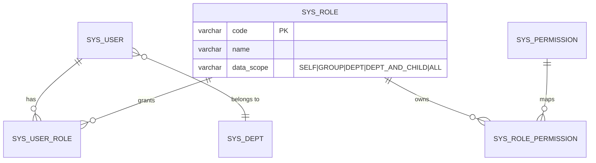
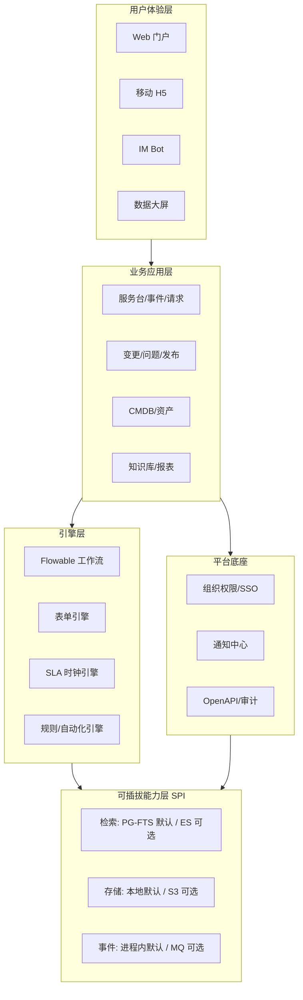
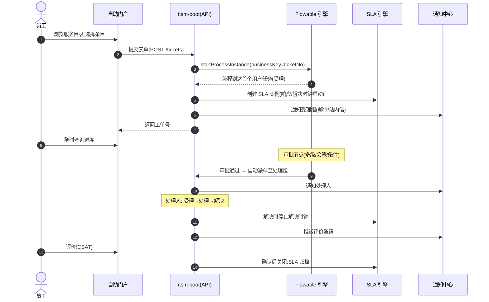
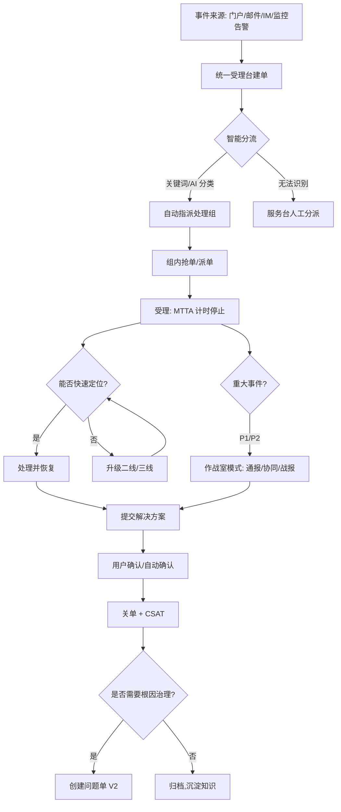
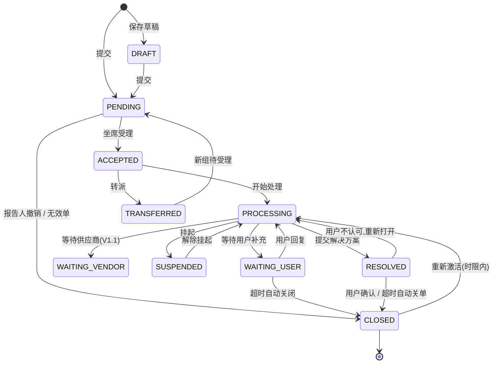
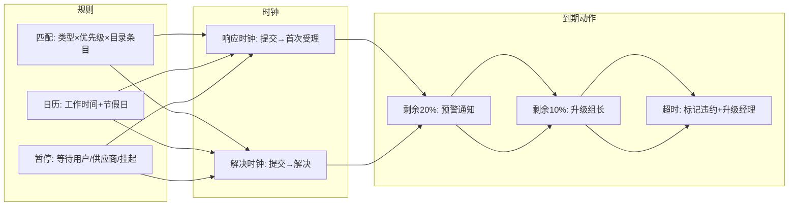
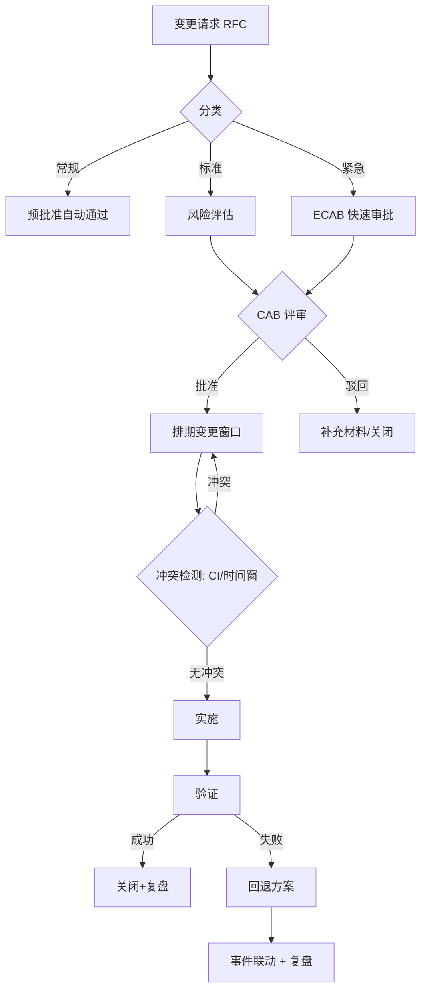
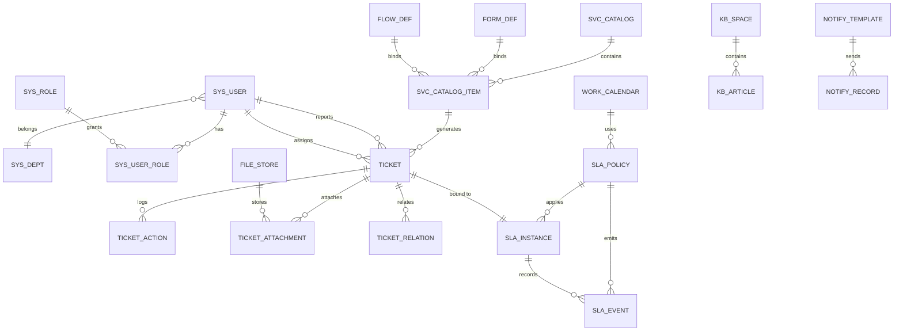
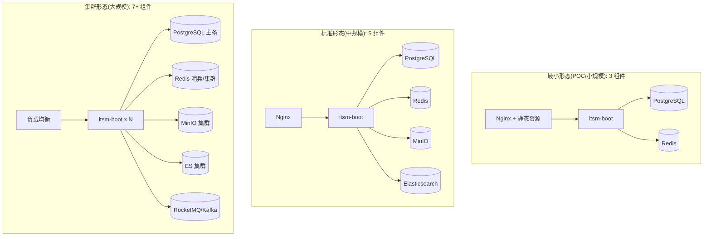

# ITSM 产品设计文档

| 项目 | 内容 |
|------|------|
| 产品名称 | ITSM 一体化 IT 服务管理平台(暂定名) |
| 文档版本 | v0.1(设计草案) |
| 编写日期 | 2026-10-04 |
| 适用范围 | 产品、研发、测试、实施团队 |

---

## 目录

1. [产品概述](#1-产品概述)
2. [术语与缩写](#2-术语与缩写)
3. [用户角色与权限设计](#3-用户角色与权限设计)
4. [产品功能架构](#4-产品功能架构)
5. [版本范围(MVP)](#5-版本范围mvp)
6. [核心业务流程设计](#6-核心业务流程设计)
7. [功能详细设计](#7-功能详细设计)
8. [数据模型设计](#8-数据模型设计)
9. [API 设计规范与清单](#9-api-设计规范与清单)
10. [技术方案设计](#10-技术方案设计)
11. [部署架构与环境要求](#11-部署架构与环境要求)
12. [非功能性需求](#12-非功能性需求)
13. [版本路线图](#13-版本路线图)
14. [风险与开放问题](#14-风险与开放问题)

---

## 1. 产品概述

### 1.1 背景与机会

- 企业 IT 服务请求渠道分散(微信/电话/口头/邮件),处理过程黑盒,无法度量;
- 故障恢复依赖个人经验,SLA 无法落地,超时无预警;
- 变更缺乏风险评估与冲突检测,人为事故频发;
- 商业产品(ServiceNow 等)价格昂贵、实施重;轻量开源工具(osTicket 等)功能割裂、无低代码能力。

**市场机会**:一款开箱即用、可私有化部署、流程表单低代码可定制、组件可插拔的新一代 ITSM 平台。

### 1.2 产品定位

> 面向中大型企业 IT 部门的**一体化、低代码、可私有化、组件可插拔**的 IT 服务管理平台。

核心理念:ITIL 4 对齐 · 低代码编排 · 移动化协作 · AI 就绪 · 轻量部署(最小依赖即可运行)。

### 1.3 目标用户与核心诉求

| 角色 | 典型用户 | 核心诉求 |
|------|---------|---------|
| 员工(提单者) | 全员 | 快速报障/提请求、随时查看进度、自助解决问题 |
| 服务台坐席 | IT Help Desk | 统一受理、高效派单、知识辅助、考核达标 |
| 二线/三线工程师 | 运维、网络、桌面、研发 | 工单不丢、上下文完整、处理留痕 |
| 流程管理员 | ITSM 流程经理 | 低代码配置流程/表单/SLA,无需开发 |
| IT 管理者 | CIO、IT 经理 | 运营度量、风险管控、资源调配 |
| 系统管理员 | IT 运维平台组 | 部署简单、集成开放、审计合规 |

### 1.4 核心价值主张

1. **全流程闭环**:从"报"(门户/IM 多渠道接入)、到"修"(事件/请求/变更/问题)、到"管"(CMDB/知识库/报表)一站式覆盖;
2. **低代码**:流程、表单、SLA 策略、通知模板全部可视化配置,业务调整不改代码;
3. **可插拔**:检索(ES)、对象存储(S3)、消息队列(MQ)全部为可选组件,无对应环境时自动降级为内置实现,**零外部依赖即可完整运行**;
4. **AI 就绪**:预留智能分类、智能派单、RAG 知识问答的扩展点与数据沉淀。

### 1.5 竞品参考与差异化

| 竞品 | 优势 | 我们的差异化机会 |
|------|------|----------------|
| ServiceNow | 功能最全、生态强 | 价格贵、实施重、私有化门槛高 |
| Jira Service Management | 研发协同好 | ITAM/CMDB 弱,流程定制门槛高 |
| Freshservice | SaaS 易用 | 私有化能力弱 |
| iTop / osTicket 等开源 | 免费 | 体验陈旧、无低代码、无中文生态 |

**差异化定位**:私有化部署友好(最小 3 组件即可运行)+ 低代码 + 中文/国产化适配 + 后续 AI 能力。

---

## 2. 术语与缩写

| 术语 | 全称 | 说明 |
|------|------|------|
| 工单 | Ticket | 平台内所有单据的统称,含事件单/请求单等 |
| 事件 | Incident | 非计划中断或服务质量下降,需要紧急恢复 |
| 服务请求 | Service Request | 标准化、预定义的服务供给请求(如开通权限) |
| 变更 | Change | 对生产环境 CI 的增删改活动 |
| 问题 | Problem | 一个或多个事件背后的根因 |
| CI | Configuration Item | 配置项,CMDB 中被管理的对象 |
| CMDB | Configuration Management Database | 配置管理数据库 |
| SLA | Service Level Agreement | 服务级别协议(响应/解决时限) |
| OLA | Operational Level Agreement | 内部支撑协议 |
| UC | Underpinning Contract | 供应商支持协议 |
| CAB | Change Advisory Board | 变更顾问委员会 |
| KEDB | Known Error Database | 已知错误数据库 |
| MTTA / MTTR | Mean Time To Acknowledge / Repair | 平均响应/解决时长 |
| CSAT | Customer Satisfaction | 客户满意度 |

---

## 3. 用户角色与权限设计

### 3.1 内置角色(可扩展)

| 角色编码 | 角色名称 | 权限概述 |
|---------|---------|---------|
| `EMPLOYEE` | 普通员工 | 提单、查看本人单据、知识浏览、评价 |
| `AGENT` | 服务台坐席 | 受理/处理/转派工单、知识编辑(草稿) |
| `ENGINEER` | 二线工程师 | 受理本组工单、处理、知识编辑 |
| `GROUP_LEADER` | 组长 | 本组工单全操作、组内派单、报表(本组) |
| `CHANGE_MANAGER` | 变更经理(V2) | 变更审批、CAB 组织、变更日历 |
| `PROBLEM_MANAGER` | 问题经理(V2) | 问题单管理、KEDB 维护 |
| `KB_ADMIN` | 知识管理员 | 知识审核发布、空间管理 |
| `REPORT_VIEWER` | 报表查看者 | 全局报表/大屏只读 |
| `SYS_ADMIN` | 系统管理员 | 组织/权限/字典/集成/审计全管理 |
| `FLOW_ADMIN` | 流程管理员 | 流程、表单、SLA 策略配置 |

### 3.2 权限模型

- **RBAC 为主体**:用户 → 角色 → 权限(菜单权限、按钮/操作权限、API 权限);
- **数据范围(Data Scope)**:`本人` / `本组` / `本部门` / `本部门及以下` / `全部`;
- **工单级 ACL 补充**:报告人、当前处理人、处理组、审批人、抄送人对单据可见可操作;
- 组织架构支持对接企业 SSO/LDAP 同步,本地账户作为兜底。



---

## 4. 产品功能架构

### 4.1 功能地图

```text
ITSM 平台
├── 自助门户(Portal)
│   ├── 服务目录浏览与搜索
│   ├── 快速报障(智能表单)
│   ├── 我的请求(进度跟踪)
│   ├── 知识中心(FAQ/检索)
│   └── 公告与通知
├── 服务台(Service Desk)
│   ├── 统一受理台(多渠道建单)
│   ├── 工单工作台(我的待办/处理中/挂起/超时)
│   ├── 智能分流(规则 + 画像)
│   ├── 升级机制(临期提醒/自动升级)
│   └── 满意度回访(CSAT)
├── 流程管理(ITSM Core)
│   ├── 事件管理(Incident)         [V1.0]
│   ├── 服务请求(Request)          [V1.0]
│   ├── 变更管理(Change)           [V2.0]
│   ├── 问题管理(Problem)          [V2.0]
│   └── 发布管理(Release)          [V2.1]
├── 服务级别管理(SLM)
│   ├── SLA 策略配置
│   ├── 工作日历(节假日/工作时间)
│   ├── 时钟引擎(暂停/恢复)
│   └── 预警与自动升级
├── 服务目录(S Catalog)
│   ├── 目录分类管理
│   ├── 服务条目(表单+流程+SLA 绑定)
│   └── 目录发布与审核
├── 知识库(Knowledge)
│   ├── 知识空间与文章
│   ├── 审核发布流
│   ├── 全文检索
│   └── 工单智能推荐知识
├── CMDB(V2.0)
│   ├── CI 模型管理(类型/属性/关系)
│   ├── 自动发现(Agent/API/云同步)  [V2.1]
│   ├── 拓扑视图与影响分析
│   └── 基线与变更审计
├── 资产管理 ITAM(V2.1)
│   ├── 资产台账与全生命周期
│   ├── 库存盘点(扫码)
│   └── 到期提醒(保修/租约)
├── 报表与度量
│   ├── 运营看板(实时)
│   ├── 预置报表(KPI 30+)
│   ├── 自定义报表
│   └── 数据大屏
├── 智能化 AI(V3.0)
│   ├── 智能客服机器人(RAG)
│   ├── 智能分类与派单
│   ├── 相似工单/知识推荐
│   └── SLA 风险预测
└── 平台支撑(Platform)
    ├── 组织与权限(RBAC/SSO/LDAP)
    ├── 低代码流程引擎(Flowable + bpmn-js)
    ├── 表单引擎(JSON Schema + 渲染器)
    ├── 通知中心(邮件/站内信/Webhook/IM)
    ├── 集成中心(OpenAPI/Webhook/连接器)
    ├── 消息与事件总线(可插拔 MQ)
    ├── 检索服务(可插拔 ES)
    ├── 文件存储(可插拔 S3)
    └── 系统管理(字典/审计/参数/备份)
```

### 4.2 架构分层



---

## 5. 版本范围(MVP)

### 5.1 V1.0(MVP)范围内

| 模块 | 范围 |
|------|------|
| 平台底座 | 登录鉴权(JWT)、组织/部门/用户、角色权限、数据字典、审计日志 |
| 流程引擎 | Flowable 集成、2 条预置流程(事件流/请求流)、bpmn-js 设计器 |
| 表单引擎 | 表单设计器(12+ 控件)、表单渲染、JSONB 存储 |
| 服务台 | 统一建单、工单工作台、受理/处理/转派/挂起/解决/关闭全动作 |
| 事件管理 | 优先级矩阵、事件单全生命周期、关联合并 |
| 服务请求 | 服务目录(2 级)、请求模板、多级审批 |
| SLA | 策略配置、工作日历、计时/暂停、临期预警、超时升级 |
| 通知中心 | 邮件 + 站内信 + Webhook,模板管理 |
| 知识库 | 空间/文章/审核发布/检索 |
| 报表 | 服务台看板(实时)、工单量/SLA 达成/满意度 3 类预置报表 |
| 可插拔底座 | 检索/存储/事件三大 SPI + 默认实现 |

### 5.2 V1.0 明确不做(Out of Scope)

- 变更/问题/CMDB/资产/发布管理(V2.x);
- 移动端 App(仅做 H5 适配);
- AI 能力(V3.0);
- 多租户(架构预留,单租户交付);
- 工作量计时/工时费率。

---

## 6. 核心业务流程设计

### 6.1 服务请求全流程(时序)



### 6.2 事件管理流程(泳道)



### 6.3 工单状态机(V1.0 通用)



**动作 × 状态权限矩阵(节选)**

| 动作 | PENDING | ACCEPTED | PROCESSING | WAITING | RESOLVED | CLOSED |
|------|---------|----------|------------|---------|----------|--------|
| 受理 | 坐席/组内 | — | — | — | — | — |
| 回复 | — | ✓ | ✓ | ✓ | ✓ | — |
| 转派 | ✓ | ✓ | ✓ | ✓ | — | — |
| 挂起 | — | ✓ | ✓ | — | — | — |
| 解决 | — | ✓ | ✓ | ✓ | — | — |
| 关闭 | 报告人 | — | — | — | 报告人/超时 | — |
| 重开 | — | — | — | — | — | 报告人(≤7天) |

### 6.4 SLA 计时规则



- 计时基于 `sla_instance` 记录累计暂停秒数,到期时间 = 自然到期时间 + 暂停补偿;
- Redis ZSet 按 `resolve_deadline` 排序扫描临期工单,兜底数据库定时任务(每分钟)保证不丢;
- 时钟事件全部落库(`sla_event`),支持审计回放。

### 6.5 变更管理流程(V2.0 预览)



---

## 7. 功能详细设计(V1.0)

### 7.1 自助门户

| 功能点 | 说明 |
|--------|------|
| 服务目录 | 卡片式分类导航、关键词搜索、常用收藏 |
| 快速报障 | 3 步建单:类型 → 描述(富文本/截图粘贴)→ 确认;表单由目录条目驱动 |
| 我的请求 | 列表(状态标签/SLA 剩余时间)、详情进度条(节点可视化)、催办按钮 |
| 知识中心 | 热门知识、全文检索、知识详情反馈(有帮助/无帮助) |
| 消息通知 | 站内信红点、未读列表、通知偏好设置 |
| 评价 | 关单推送评分(1-5 星)+ 标签(速度快/态度好/专业)+ 文本 |

### 7.2 服务台工作台

| 功能点 | 说明 |
|--------|------|
| 我的待办 | 待受理/待处理/待审批/待评价 分栏,按 SLA 剩余时间排序 |
| 全部工单 | 高级筛选(状态/类型/优先级/组/人/渠道/时间)、保存筛选条件 |
| 工单详情 | 基本信息卡、表单数据、处理时间线、附件、SLA 状态、关联单 |
| 批量操作 | 批量派单/关闭/导出 |
| 快捷回复 | 个人/组级常用语模板 |
| 智能分流规则 | 条件(标题关键词/渠道/目录)→ 动作(指定组/优先级/标签) |

### 7.3 工单中心(核心实体)

**工单主表单字段**

| 字段 | 说明 |
|------|------|
| ticket_no | 单号,规则 `IR-YYYYMMDD-SEQ`,类型前缀区分 |
| type | INCIDENT / REQUEST |
| title / description | 标题 + 富文本描述(图片粘贴) |
| catalog_item_id | 关联服务目录条目(请求单必填) |
| form_data | 动态表单数据(JSONB) |
| urgency × impact | 紧急度(高/中/低)× 影响(广/局部/单点)→ 优先级矩阵 |
| channel | PORTAL / EMAIL / IM / PHONE / MONITOR / API |
| reporter / assignee / assignee_group | 报告人/处理人/处理组 |
| flow_instance_id | Flowable 流程实例 ID |
| status | 状态机见 6.3 |
| 关联字段 | first_response_at / resolved_at / closed_at / reopen_count |

**优先级矩阵**

| 影响 \ 紧急度 | 高 | 中 | 低 |
|--------------|----|----|----|
| 广 | P1 | P2 | P3 |
| 局部 | P2 | P3 | P4 |
| 单点 | P3 | P4 | P4 |

### 7.4 服务目录

- 目录两级分类(如「办公支持 / 账号权限」);
- 条目 = 表单定义 + 流程模板 + SLA 策略 + 默认处理组 + 图标 + 描述 + 启用状态;
- 条目变更走「草稿 → 预览 → 发布」审核;
- 典型预置条目:VPN 开通、邮箱申请、软件安装、硬件报修、门禁申请。

### 7.5 表单设计器(低代码核心)

| 控件 | 类型 |
|------|------|
| 基础 | 单行/多行文本、数字、日期、时间、开关 |
| 选择 | 单选/多选、下拉、级联、字典选择 |
| 组织 | 人员选择、部门选择(对接组织架构) |
| 业务 | CI 选择(V2 预留)、附件、子表格 |
| 展示 | 说明文字、分割线 |

- 表单定义:JSON Schema(控件树 + 校验 + 联动规则:显示/隐藏/必填);
- 节点字段权限:流程各节点可配置字段「隐藏/只读/可编辑」;
- 存储:`form_data JSONB`,GIN 索引支持按控件值检索。

### 7.6 SLA 管理

- 策略列表:匹配条件(工单类型 + 目录条目 + 优先级)→ 响应时限/解决时限;
- 工作日历:周工作时段 + 节假日表,支持多时区(默认单时区);
- 暂停规则:可配置哪些状态触发暂停;
- 实例监控:实时列表按「剩余时间」排序,颜色分级(正常/预警/临期/超时)。

### 7.7 知识库

- 空间(Space)→ 分类 → 文章;可见性:公开/登录可见/指定组;
- 状态流:DRAFT → IN_REVIEW → PUBLISHED → ARCHIVED,支持版本历史与回滚;
- 编辑:Markdown + 富文本双模式,图片粘贴上传,附件;
- 检索:走统一 SearchEngine SPI(PG-FTS 默认 / ES 增强);
- 工单联动:处理工单时侧栏推荐相关知识(标题+标签相似度,V1 为关键词,V3 升级语义)。

### 7.8 报表与看板

| 看板/报表 | 指标 |
|-----------|------|
| 服务台实时看板 | 今日建单/待受理/处理中/超时数、各状态漏斗、组负载 |
| 工单量报表 | 按日/周/月 × 类型/目录/渠道/部门 趋势 |
| SLA 报表 | 响应/解决达成率(按优先级/组)、超时明细 |
| 效率报表 | MTTA/MTTR 趋势、首次解决率、 reopen 率、人均处理量 |
| 满意度报表 | CSAT 趋势、低分明细与回访记录 |
| 导出 | 报表导出 Excel/CSV,支持定时订阅(邮件) |

### 7.9 通知中心

- 渠道:`EMAIL`(SMTP)/ `INAPP`(站内信)/ `WEBHOOK`;IM(飞书/企微/钉钉)以连接器形式 V1.1 提供;
- 模板:变量占位符(`{{ticket_no}}`、`{{assignee}}`、`{{sla_remaining}}`),支持 HTML 邮件;
- 触发场景:建单确认、受理通知、待审批提醒、临期预警、升级通知、解决/关单通知、评价邀请;
- 可靠性:通知记录落库,失败重试 3 次(指数退避),启用 MQ 后异步削峰。

### 7.10 系统管理

- 用户/部门/角色/权限管理,支持批量导入(Excel);
- 数据字典(优先级、渠道、状态标签等);
- 操作审计:登录、单据操作、配置变更全量审计(AOP 切面);
- 系统参数:单号规则、附件限制、密码策略、Token 有效期;
- 集成管理:OpenAPI Token(凭证/限流/审计)、Webhook 订阅配置、连接器(监控告警→自动建单,V1.1)。

---

## 8. 数据模型设计

### 8.1 核心 ER 图(V1.0)



### 8.2 核心表结构说明

#### 平台域

| 表 | 说明 | 关键字段 |
|----|------|---------|
| `sys_user` | 用户 | id, username, password_hash, display_name, email, phone, dept_id, status |
| `sys_dept` | 部门(树) | id, parent_id, path, name, leader_id, sort |
| `sys_role` | 角色 | code, name, data_scope |
| `sys_permission` | 权限(菜单/API/按钮) | code, name, type, parent_id, api_path |
| `sys_dict` | 字典 | dict_type, code, label, extra(jsonb), sort |
| `sys_audit_log` | 审计 | user_id, action, target_type, target_id, detail(jsonb), ip, ua, created_at |
| `sys_config` | 参数 | config_key, config_value, remark |

#### 服务目录与表单

| 表 | 说明 | 关键字段 |
|----|------|---------|
| `svc_catalog` | 目录分类 | name, icon, parent_id, sort, status |
| `svc_catalog_item` | 目录条目 | code, name, catalog_id, form_def_id, flow_def_key, sla_policy_id, owner_group_id, icon, description, status |
| `form_def` | 表单定义 | code, name, schema(jsonb), version, status |
| `flow_def` | 流程定义注册 | flow_key, name, bpmn_xml, version, deploy_id |

#### 工单域

| 表 | 说明 | 关键字段 |
|----|------|---------|
| `ticket` | 工单主表 | ticket_no(唯一), type, title, description, catalog_item_id, form_data(jsonb), urgency, impact, priority, status, channel, reporter_id, assignee_id, assignee_group_id, flow_instance_id, first_response_at, resolved_at, closed_at, reopen_count, deleted |
| `ticket_action` | 处理记录(时间线) | ticket_id, actor_id, action, comment, from_status, to_status, extra(jsonb), created_at |
| `ticket_attachment` | 附件关联 | ticket_id, file_id, name |
| `ticket_relation` | 工单关联 | from_ticket_id, to_ticket_id, relation_type(RELATED/DUPLICATE/BLOCK) |
| `ticket_watch` | 关注/抄送 | ticket_id, user_id, notify_flag |

#### SLA 域

| 表 | 说明 | 关键字段 |
|----|------|---------|
| `work_calendar` | 工作日历 | name, timezone, work_days(jsonb), holidays(jsonb) |
| `sla_policy` | SLA 策略 | code, ticket_type, catalog_item_id, priority, response_minutes, resolve_minutes, calendar_id, pause_rules(jsonb), status |
| `sla_instance` | 工单 SLA 实例 | ticket_id(唯一), policy_id, response_deadline, resolve_deadline, paused_seconds, timer_state(RUNNING/PAUSED/STOPPED), response_breach, resolve_breach |
| `sla_event` | 时钟事件 | instance_id, event(START/PAUSE/RESUME/STOP/BREACH), occurred_at, reason |

#### 知识库 / 通知 / 文件

| 表 | 说明 | 关键字段 |
|----|------|---------|
| `kb_space` | 知识空间 | name, visibility, owner_id |
| `kb_article` | 知识文章 | space_id, title, content, tags, status, version, author_id, reviewer_id, view_count, helpful_count |
| `notify_template` | 通知模板 | code, channel, title_tpl, content_tpl, variables |
| `notify_record` | 通知记录 | template_id, channel, receiver, subject, payload(jsonb), status, retry_count, sent_at |
| `file_store` | 文件元数据 | storage_key, name, content_type, size, sha256, storage_type(LOCAL/S3), bucket, created_by |

#### Flowable 引擎表(自动创建)

`ACT_RE_*(定义)` / `ACT_RU_*(运行时)` / `ACT_HI_*(历史)` / `ACT_GE_*(通用)`,与业务同库,保证业务与流程**同事务**一致性;工单与流程实例通过 `business_key = ticket_no` 关联。

### 8.3 设计约定

- 主键:业务表用 `BIGINT` 雪花 ID;字典/配置类可用序列;
- 审计字段统一:`created_by, created_at, updated_by, updated_at`;
- 逻辑删除:`deleted BOOLEAN`(工单/知识/目录),审计日志物理保留;
- 枚举统一小写下划线字符串存储,字典表维护展示文案;
- JSONB 用于:form_data、schema、pause_rules、extra 等半结构化数据。

---

## 9. API 设计规范与清单

### 9.1 规范

- 风格:RESTful,路径 `/api/v1/...`,资源名词复数,动作语义用子资源(如 `/tickets/{id}/actions`);
- 认证:`Authorization: Bearer <JWT>`;OpenAPI 集成调用走独立 Token(`X-Api-Token`)并限流;
- 统一响应:

```json
{ "code": 0, "message": "ok", "data": {}, "traceId": "8f3a..." }
```

- 错误码:`ITS-4xx-0001` 形式(HTTP 语义 + 业务域 + 序号),错误码表随文档维护;
- 分页:`?page=1&size=20&sort=created_at,desc`,响应含 `total/records`;
- 幂等:创建类接口支持 `Idempotency-Key` 头;
- 文档:SpringDoc OpenAPI 3 自动生成,`/swagger-ui.html`。

### 9.2 核心 API 清单(V1.0)

| 方法 | 路径 | 说明 |
|------|------|------|
| POST | `/api/v1/auth/login` | 账号密码登录,签发 JWT |
| POST | `/api/v1/auth/refresh` | 刷新令牌 |
| GET | `/api/v1/me` | 当前用户信息与权限 |
| GET | `/api/v1/catalogs` | 服务目录树 |
| GET | `/api/v1/catalog-items` | 目录条目列表/搜索 |
| POST | `/api/v1/tickets` | 创建工单(草稿/直接提交) |
| GET | `/api/v1/tickets` | 工单分页查询(多维筛选) |
| GET | `/api/v1/tickets/{id}` | 工单详情(含表单/SLA/时间线) |
| POST | `/api/v1/tickets/{id}/actions` | 工单动作:accept/reply/transfer/suspend/resolve/close/reopen |
| POST | `/api/v1/tickets/{id}/attachments` | 上传附件 |
| GET | `/api/v1/tickets/{id}/activities` | 处理时间线 |
| POST | `/api/v1/tickets/{id}/rate` | 满意度评价 |
| GET | `/api/v1/workbench/todo` | 我的待办(分栏聚合) |
| GET | `/api/v1/tasks/{taskId}/form` | 任务节点表单(含字段权限) |
| POST | `/api/v1/tasks/{taskId}/complete` | 完成流程任务(审批) |
| GET | `/api/v1/dashboard/overview` | 服务台看板聚合数据 |
| GET | `/api/v1/reports/ticket-trend` | 工单趋势报表 |
| GET | `/api/v1/reports/sla-summary` | SLA 达成报表 |
| GET | `/api/v1/kb/spaces` / `kb/articles` | 知识空间/文章 |
| POST | `/api/v1/search` | 统一全文检索(工单/知识) |
| POST | `/api/v1/files` | 通用文件上传(返回 file_id) |
| GET | `/api/v1/files/{id}/content` | 文件下载(鉴权代理) |
| POST | `/api/v1/admin/forms` / PUT `/{id}` | 表单定义管理 |
| POST | `/api/v1/admin/flows/deploy` | BPMN 流程部署 |
| POST | `/api/v1/admin/catalog-items` | 目录条目管理 |
| POST | `/api/v1/admin/sla-policies` | SLA 策略管理 |
| POST | `/api/v1/admin/calendars` | 工作日历管理 |
| POST | `/api/v1/admin/notify-templates` | 通知模板管理 |
| CRUD | `/api/v1/admin/users|depts|roles|dicts` | 平台管理 |

---

## 10. 技术方案设计

### 10.1 技术栈清单(必选核心)

| 层次 | 技术 | 版本 | 说明 |
|------|------|------|------|
| 运行时 | Java | 17 LTS | 虚拟线程可用(Boot 3.2+) |
| 应用框架 | Spring Boot | 3.2.x | Web + Security + Validation |
| 安全 | Spring Security + jjwt | 6.x | JWT 认证 + 方法级授权 |
| 工作流 | Flowable | 7.0.x | BPMN 2.0,官方支持 Boot3/jakarta |
| ORM | MyBatis-Plus | 3.5.x | `mybatis-plus-spring-boot3-starter` |
| 数据库 | PostgreSQL | 14+ | JSONB / FTS / pg_trgm |
| 缓存 | Redis | 6+ | 缓存、SLA 时间轴、分布式锁、Token |
| 连接池 | HikariCP(默认) | — | — |
| API 文档 | SpringDoc OpenAPI | 2.x | OpenAPI 3 |
| 前端框架 | Vue | 3.4+ | Composition API + `<script setup>` |
| 构建 | Vite | 5.x | — |
| 语言 | TypeScript | 5.x | 全量 TS |
| UI 组件 | Element Plus | 2.x | — |
| 状态/路由 | Pinia / Vue Router | 2.x / 4.x | — |
| 流程设计器 | bpmn-js | 17.x | BPMN 可视化建模 |
| 图表 | ECharts | 5.x | 报表与大屏 |
| 富文本 | Tiptap(或 wangEditor) | — | 工单描述/知识编辑 |

### 10.2 可选组件与可插拔架构(核心设计)

**原则:业务代码只依赖 SPI 接口;每个可选能力提供「默认内置实现 + 外部组件实现」,通过配置开关条件装配;切库不切业务。**

| 能力 | SPI 接口 | 默认实现(零依赖) | 可选实现 | 配置开关 |
|------|---------|------------------|---------|---------|
| 全文检索 | `SearchEngine` | `PgFtsSearchEngine`(PG tsvector + pg_trgm) | `EsSearchEngine`(ES 8) | `itsm.search.engine: pg\|es` |
| 对象存储 | `ObjectStorage` | `LocalStorage`(本地磁盘 + 鉴权代理下载) | `S3Storage`(AWS SDK v2,兼容 MinIO/OSS/COS) | `itsm.storage.type: local\|s3` |
| 事件总线 | `EventBus` | `InProcessEventBus`(Spring 事件 + Outbox 表补偿) | `RocketMqEventBus` / `KafkaEventBus` | `itsm.event.bus: inprocess\|rocketmq\|kafka` |

#### 10.2.1 SPI 接口定义

```java
/** 检索 SPI */
public interface SearchEngine {
    String name();
    void index(String index, String id, Map<String, Object> doc);   // 写入索引
    void delete(String index, String id);
    Page<SearchHit> search(SearchQuery query);                       // 统一查询 DSL
}

/** 对象存储 SPI */
public interface ObjectStorage {
    StoredFile put(FileUpload upload);                               // 上传
    InputStream get(String key);                                     // 流式读取
    void remove(String key);
    String presignedUrl(String key, Duration ttl);                   // 预签名(本地实现返回代理URL)
}

/** 事件总线 SPI */
public interface EventBus {
    void publish(DomainEvent event);                                 // 发布领域事件
    void subscribe(String topic, DomainEventListener listener);      // 订阅
}
```

#### 10.2.2 条件装配(Auto-Configuration)

```java
@AutoConfiguration
@EnableConfigurationProperties(ItsSearchProps.class)
public class SearchAutoConfiguration {

    @Bean
    @ConditionalOnProperty(name = "itsm.search.engine", havingValue = "es")
    @ConditionalOnClass(ElasticsearchClient.class)
    public SearchEngine esSearchEngine(ElasticsearchClient client) {
        return new EsSearchEngine(client);
    }

    @Bean
    @ConditionalOnMissingBean(SearchEngine.class)   // 默认兜底:PG 全文检索
    public SearchEngine pgFtsSearchEngine(NamedParameterJdbcTemplate jdbc) {
        return new PgFtsSearchEngine(jdbc);
    }
}
```

> 注册于 `META-INF/spring/org.springframework.boot.autoconfigure.AutoConfiguration.imports`,按 starter 打包:`itsm-search-starter`、`itsm-storage-starter`、`itsm-event-starter`。未引入 ES 依赖时,es 实现类根本不在 classpath,装配天然安全。

#### 10.2.3 统一配置(默认值即最小依赖形态)

```yaml
itsm:
  search:
    engine: pg                    # pg(默认) | es
    es:
      hosts: http://127.0.0.1:9200
      username: ""
      password: ""
  storage:
    type: local                   # local(默认) | s3
    local:
      path: ${user.dir}/data/files
      url-prefix: /api/v1/files
    s3:
      endpoint: http://127.0.0.1:9000
      bucket: itsm
      access-key: ""
      secret-key: ""
      path-style: true            # MinIO 需 true
  event:
    bus: inprocess                # inprocess(默认) | rocketmq | kafka
    outbox:
      retry-interval: 30s
      max-retry: 5
```

#### 10.2.4 降级与增强策略说明

| 场景 | 默认形态 | 增强形态 |
|------|---------|---------|
| 检索 | PG `tsvector(simple)` + `pg_trgm` ILIKE 组合,中文可插 `zhparser` 扩展自动探测(有则用,无则降级 pg_trgm) | ES ik 中文分词,聚合/高亮/排序增强 |
| 附件 | 本地磁盘存储,下载统一走 `/api/v1/files/{id}/content` 鉴权代理,支持断点续传 | S3 预签名直传/直下,减轻应用带宽 |
| 事件 | 进程内 `ApplicationEvent` + `@TransactionalEventListener(AFTER_COMMIT)`;Outbox 表 `event_outbox` 保证至少一次,单机定时任务扫描重试 | MQ 异步化/削峰/广播;Outbox 复用为 MQ 发件箱,语义不变 |
| SLA 扫描 | Redis ZSet + 单机 `@Scheduled`(Redis 不可用时自动降级为纯 DB 扫描) | 分布式锁(Redisson)多实例分片扫描 |

#### 10.2.5 扩展新实现的方法

1. 在对应 starter 中新增实现类实现 SPI 接口;
2. 增加 `@ConditionalOnProperty` 分支与配置类;
3. 业务代码零改动,配置文件切换 `engine/type/bus` 即生效。

### 10.3 工程结构(模块化单体,预留微服务拆分)

```text
itsm/
├── pom.xml                      # 父 POM(模块聚合 + 插件管理)
├── itsm-dependencies/           # BOM:统一三方版本
├── itsm-common/                 # 通用:Result/异常/错误码/工具/常量
├── itsm-domain/                 # 领域:实体、枚举、领域事件定义(无框架依赖)
├── itsm-engine/                 # 引擎封装:
│   ├── flowable   流程服务封装(启动/任务/监听器/业务回调)
│   ├── form       表单引擎(Schema 校验/渲染模型/字段权限)
│   ├── sla        SLA 时钟引擎(ZSet 扫描/暂停恢复/升级)
│   └── rule       规则引擎(分流规则/自动化动作)
├── itsm-module-platform/        # 平台:组织/权限/字典/通知/审计/文件/集成
├── itsm-module-ticket/          # 服务台:事件/请求/工作台/评价
├── itsm-module-catalog/         # 服务目录 + 表单定义管理
├── itsm-module-knowledge/       # 知识库
├── itsm-module-report/          # 报表看板
├── itsm-boot/                   # 唯一启动器(装配全部模块,打包 FatJar)
├── itsm-ui/                     # Vue3 前端(独立构建,Nginx/静态资源托管)
├── deploy/                      # 部署物:Dockerfile / docker-compose.yml / helm chart
└── docs/                        # 设计文档
```

依赖方向:`boot → module-* → engine → domain → common`;starter(storage/search/event)仅被 boot 装配,业务只 import SPI 接口包(common 内)。

**为何单体起步**:V1.0 工单跨模块强一致、交付团队小、私有化部署运维简单;模块边界按 DDD 划分,后续可优先拆出「通知」「检索」「报表」等独立服务。

### 10.4 关键技术机制

#### A. 流程与业务解耦

- 工单表保存 `flow_instance_id`,Flowable `business_key = ticket_no`;
- 预置流程模板:事件流程(受理→处理→解决→关闭)、请求流程(审批链→派单→处理);
- 监听器桥接:`TaskCreateListener` → 触发通知与 SLA 响应时钟;`TaskCompleteListener` → 触发业务回调;
- 流程版本化管理:新版本发布后存量实例走旧版本,Flowable 原生支持。

#### B. SLA 时钟引擎

- 写路径:工单状态变更事件 → `SlaClockService.pause/resume/stop` → 更新 `sla_instance` + 记录 `sla_event`;
- 扫描路径:Redis ZSet `itsm:sla:deadline`(score=resolve_deadline 时间戳)每 30s 扫描临期(20%/10%)与超时单 → 触发预警/升级事件;Redis 异常时自动切换 DB 扫描(`status='RUNNING' AND resolve_deadline < now()` 加索引);
- 日历计算:响应/解决到期时间按工作日历换算,暂停秒数累加补偿。

#### C. 表单引擎

- Schema 结构:`{ controls: [...], rules: [...], layout: "vertical" }`,控件含 `type/key/label/required/visible-when`;
- 服务端校验:按 Schema 反射校验提交的 `form_data`(必填/类型/长度/枚举),前端渲染器同源 Schema;
- 节点权限:流程节点绑定 `{fieldKey: HIDDEN|READONLY|EDITABLE}`,任务查询接口按当前节点裁剪;
- 检索:常用筛选项(如申请内容关键字)通过 JSONB 运算符 + GIN 索引实现。

#### D. 安全设计

- 密码:BCrypt;密码策略可配;连续失败锁定;
- Token:JWT(15min)+ Refresh Token(7d,Redis 可吊销);OpenAPI Token 独立签发与限流(Bucket4j + Redis);
- 越权防护:所有工单接口经 `TicketAccessGuard` 数据权限校验(报告人/处理人/组/角色矩阵);
- 附件:后缀白名单 + 大小限制 + 存储键随机化;下载必须带鉴权(本地实现走代理接口,S3 预签名短时效);
- 审计:AOP `@AuditLog` 注解,异步落库;
- 前端:路由守卫 + 按钮级权限指令 `v-perm`。

#### E. 通知可靠性

- 状态机:PENDING → SENDING → SENT / FAILED(重试 3 次退避);
- 发送抽象 `Notifier` 接口,渠道实现插件化;IM 渠道(V1.1)以 connector 模块接入;
- 用户通知偏好:可按渠道/场景关闭非强制通知。

### 10.5 前端架构

```text
itsm-ui/
├── src/
│   ├── api/            # 接口封装(按域拆分)
│   ├── components/     # 通用组件(FormRenderer/FlowViewer/TicketStatusTag...)
│   ├── composables/    # useAuth/usePermission/useSlaCountdown...
│   ├── layouts/        # 门户布局 / 工作台布局
│   ├── modules/
│   │   ├── portal/     # 自助门户
│   │   ├── desk/       # 服务台工作台/工单详情
│   │   ├── kb/         # 知识库
│   │   ├── report/     # 报表
│   │   └── admin/      # 系统管理/表单设计器/流程设计器
│   ├── router/
│   ├── stores/
│   └── utils/
├── package.json
└── vite.config.ts
```

- 表单渲染器 `FormRenderer`:Schema → 动态组件映射,支持联动规则;
- 流程设计器:bpmn-js 封装,内置 ITSM 角色泳道与监听器配置面板;
- 工单时间线组件、SLA 倒计时组件(实时刷新)。

---

## 11. 部署架构与环境要求

### 11.1 部署形态总览

产品需同时适配**三种宿主环境**:虚拟机(VM)、Docker、Kubernetes;每种环境下按规模分三档:

| 维度 | 取值 |
|------|------|
| 宿主环境 | 虚拟机部署 / Docker 部署 / K8s 部署(交付物不同,应用与配置零改动) |
| 规模分档 | 最小(3 组件)/ 标准(5 组件)/ 集群(7+ 组件) |



| 形态 | 组件 | 适用 |
|------|------|------|
| 最小 | Nginx + itsm-boot + PG + Redis | ≤ 200 人,POC,全部默认实现 |
| 标准 | + MinIO + ES | 中型企业,附件多/检索要求高 |
| 集群 | + MQ + 多实例 + PG/Redis 高可用 | 大型企业,高可用要求 |

> 环境与规模正交:三种宿主环境均可按需选择规模分档。

### 11.2 发布交付物(一次构建,三处部署)

CI 对每个版本统一产出以下交付物,同一镜像/制品在三种环境间不做差异化构建:

| 交付物 | 说明 | 适用环境 |
|--------|------|---------|
| `itsm-boot.jar`(前端静态资源内嵌) | FatJar,内置 Flyway 建表/升级脚本 | 虚拟机 |
| `itsm/server:<ver>` Docker 镜像 | 多阶段构建,JDK17 基础镜像,分层 Jar 缓存优化 | Docker / K8s |
| Helm Chart(`itsm-<ver>.tgz`) | K8s 一键安装;values 可选启用 PG/Redis/MinIO 子 chart | K8s |
| `docker-compose.yml` | 单机编排模板:boot + PG + Redis(+ 可选 MinIO/ES) | Docker |
| `itsm-ui-dist.tar.gz`(可选) | 前端独立构建产物(客户自带 Nginx 托管场景) | 虚拟机 / Docker |
| `schema/` 与升级说明 | Flyway SQL 基线 + 手动升级/回滚指引 | 全部 |

镜像 tag 规范:`<ver>` 正式版、`<ver>-rc` 预发布;`latest` 仅限开发环境。

### 11.3 部署适配的关键技术设计(三环境共用)

同一应用在 VM / Docker / K8s 无差别运行,依赖以下平台无关设计:

1. **配置三级外置**:代码内置默认值 → 外部配置文件 → 环境变量覆盖。启动参数 `spring.config.additional-location=file:${ITS_CONFIG_DIR}/application.yaml`;所有关键参数提供 `ITS_*` 环境变量等价项,容器/K8s 直接注入;
2. **应用无状态**:无本地会话;缓存以 Redis 为准或支持失效广播。local 附件存储仅允许单实例形态,**应用启动自检发现多副本 + local 存储即告警拦截**,多副本强制 S3/MinIO;
3. **优雅启停**:`server.shutdown=graceful` + `spring.lifecycle.timeout-per-shutdown-phase=30s`,Flowable 异步执行器随上下文有序关闭;K8s preStop 先摘流量再等待存量请求完成;
4. **健康探针分级**:liveness(进程存活)与 readiness(含 PG/Redis/存储依赖检查)分离,暴露 `/actuator/health/liveness|readiness`;K8s 探针、Docker healthcheck、VM 巡检脚本与负载均衡统一复用;
5. **数据库自迁移**:内置 Flyway,首启自动建表、升级自动增量;PG 下 Flyway 依托 advisory lock,多副本并发启动安全;K8s 形态推荐 pre-upgrade Job 显式迁移(fail-fast);
6. **日志输出标准流**:Logback 双 Appender(stdout JSON + 文件滚动),容器环境采集 stdout,VM 环境落盘轮转;
7. **时区/编码统一**:镜像与启动脚本统一 `TZ=Asia/Shanghai`、`-Dfile.encoding=UTF-8`,启动自检 DB 会话时区并告警。

### 11.4 虚拟机部署(VM)

**适用**:无容器基础设施的传统企业内网/私有化交付。

**拓扑**:FatJar 由 systemd 托管;前端由 Boot 内嵌静态资源直出(或客户 Nginx 托管);PG/Redis 可同机(POC)或独立主机(生产)。

**目录规范**

```text
/opt/itsm/
├── bin/        # itsm-boot.jar、itsmctl.sh(start/stop/status/upgrade)
├── config/     # application.yaml(外置配置)
├── data/       # local 存储目录(附件)
├── logs/       # 应用日志(按天滚动,保留 30 天)
└── backup/     # 升级前自动备份(jar + config)
```

**systemd 单元(itsm.service,要点)**

```ini
[Unit]
Description=ITSM Server
After=network.target postgresql.service redis.service

[Service]
User=itsm
Environment=ITS_CONFIG_DIR=/opt/itsm/config
Environment=JAVA_OPTS=-Xms1g -Xmx2g -Dfile.encoding=UTF-8
ExecStart=/usr/bin/java $JAVA_OPTS -jar /opt/itsm/bin/itsm-boot.jar
SuccessExitStatus=143
Restart=on-failure
RestartSec=10
LimitNOFILE=65536

[Install]
WantedBy=multi-user.target
```

**升级 / 回滚**:执行 `itsmctl.sh upgrade` → 停服 → 备份 jar/config → 替换 jar → 起服(Flyway 自动增量)。回滚 = 还原备份 jar;Flyway 不自动降级,需按审核后的回滚脚本执行。

**交付检查单**:JDK17 预检安装;防火墙仅放行 80/443 与运维网段;PG/Redis 独立主机 + 每日备份;JVM 参数按主机内存调整。

### 11.5 Docker 部署

**适用**:单机快速交付、POC 演示、中小规模生产(数据落宿主卷)。

**镜像构建(Dockerfile,多阶段 + 分层)**

```dockerfile
FROM eclipse-temurin:17-jdk AS build
WORKDIR /build
COPY itsm-boot/target/itsm-boot.jar app.jar
RUN java -Djarmode=layertools -jar app.jar extract

FROM eclipse-temurin:17-jre
WORKDIR /app
ENV TZ=Asia/Shanghai JAVA_OPTS="-XX:MaxRAMPercentage=75.0"
# 分层 COPY:依赖层稳定、业务层变化小,构建与拉取缓存友好
COPY --from=build /build/dependencies/ ./
COPY --from=build /build/spring-boot-loader/ ./
COPY --from=build /build/snapshot-dependencies/ ./
COPY --from=build /build/application/ ./
ENTRYPOINT ["java","org.springframework.boot.loader.launch.JarLauncher"]
EXPOSE 8080
```

> 健康检查由编排层承担:docker-compose 配置 healthcheck,K8s 使用探针;基础镜像按需加装 curl/wget。

**单机编排(docker-compose.yml,随版本发布)**

```yaml
services:
  itsm:
    image: registry.example.com/itsm/server:1.0.0
    ports: ["8080:8080"]
    environment:
      SPRING_DATASOURCE_URL: jdbc:postgresql://postgres:5432/itsm
      SPRING_DATASOURCE_USERNAME: itsm
      SPRING_DATASOURCE_PASSWORD: ${DB_PWD}
      SPRING_DATA_REDIS_HOST: redis
      ITS_STORAGE_TYPE: local
      TZ: Asia/Shanghai
    volumes:
      - itsm-data:/app/data          # local 附件存储
      - ./config:/app/config:ro      # 外置配置
    depends_on:
      postgres: { condition: service_healthy }
      redis: { condition: service_healthy }
  postgres:
    image: postgres:16
    environment: [POSTGRES_DB=itsm, POSTGRES_USER=itsm, POSTGRES_PASSWORD=${DB_PWD}]
    volumes: [pg-data:/var/lib/postgresql/data]
    healthcheck: { test: ["CMD-SHELL", "pg_isready -U itsm"], interval: 10s }
  redis:
    image: redis:7
    volumes: [redis-data:/data]
  # —— 可选增强组件,按需取消注释 ——
  # minio:
  #   image: minio/minio
  #   command: server /data --console-address ":9001"
  #   volumes: [minio-data:/data]
  # elasticsearch:
  #   image: elasticsearch:8.14.3
  #   environment: [discovery.type=single-node, xpack.security.enabled=false]
volumes: { pg-data: {}, redis-data: {}, minio-data: {}, itsm-data: {} }
```

**要点**

- `docker compose up -d` 一键启动,首次启动 Flyway 自动建库表;
- 数据全部落卷(pg-data / redis-data / itsm-data),升级仅更换镜像 tag;
- 扩多副本时必须 `ITS_STORAGE_TYPE=s3`(MinIO 容器);local 存储多副本被应用自检拦截;
- 镜像目标体积 < 400MB(JRE + 分层)。

### 11.6 Kubernetes 部署

**适用**:云原生环境、集群形态、高可用与弹性伸缩要求。

**Helm Chart 结构(仓库 `deploy/helm/itsm/`)**

```text
deploy/helm/itsm/
├── Chart.yaml
├── values.yaml               # 全量可配:镜像/副本/资源/依赖开关
├── values-prod.yaml          # 生产参数示例
├── templates/
│   ├── deployment.yaml       # itsm-server(无状态)
│   ├── service.yaml          # ClusterIP
│   ├── ingress.yaml          # 前端与 API 同域入口
│   ├── configmap.yaml        # application.yaml 模板渲染
│   ├── secret.yaml           # DB/Redis/S3 凭证
│   ├── migrate-job.yaml      # Flyway 迁移 Job(pre-install/pre-upgrade hook)
│   ├── hpa.yaml              # CPU/内存 自动伸缩
│   ├── servicemonitor.yaml   # Prometheus Operator 指标采集
│   └── pdb.yaml              # PodDisruptionBudget
└── charts/                   # 可选子 chart:postgresql / redis / minio
```

**values.yaml 核心段(示例)**

```yaml
replicaCount: 2
image:
  repository: registry.example.com/itsm/server
  tag: "1.0.0"
resources:
  requests: { cpu: 500m, memory: 1Gi }
  limits:   { cpu: "2", memory: 2Gi }
env:
  ITS_STORAGE_TYPE: s3              # 多副本强制对象存储
  SPRING_DATA_REDIS_HOST: itsm-redis-master
postgresql:
  enabled: true                     # 指向外部 RDS 时置 false 并填 external.*
probes:
  liveness:  { path: /actuator/health/liveness,  periodSeconds: 10 }
  readiness: { path: /actuator/health/readiness, periodSeconds: 5 }
strategy:
  type: RollingUpdate
  rollingUpdate: { maxSurge: 1, maxUnavailable: 0 }
```

**K8s 适配要点**

| 关注点 | 方案 |
|--------|------|
| 滚动更新零中断 | 优雅停机 + readiness 探针 + maxUnavailable=0;preStop `sleep 10` 等待摘流与存量请求 |
| 定时任务多副本安全 | SLA 扫描、Outbox 补偿、通知重试统一走 Redis 分布式锁,任意副本可执行,无需 Pod 序号特判 |
| Flowable 异步执行器 | 基于数据库异步任务表,多副本天然安全(行级锁获取任务) |
| 配置与凭证 | ConfigMap 挂载 `/app/config`,敏感项走 Secret;变更触发滚动重启 |
| 附件 | 强制 S3/MinIO;local 存储在多副本下被应用自检拒绝启动 |
| 弹性伸缩 | HPA(CPU 70% 触发,min 2 / max 10);应用无状态,可安全扩缩容 |
| JVM 容器感知 | `-XX:MaxRAMPercentage=75.0`,按 limits 自动堆大小 |
| 安装 / 升级 | `helm upgrade --install itsm deploy/helm/itsm -f values-prod.yaml`;迁移 Job 先行执行 DB 变更 |
| 高可用 | PDB 保障驱逐时最少副本;多副本跨节点反亲和 |

### 11.7 环境要求

| 组件 | 最低版本 | 备注 |
|------|---------|------|
| JDK(仅 VM 部署需要) | 17 | Boot 3 基线;镜像内自带 |
| PostgreSQL | 14 | JSONB/FTS/pg_trgm |
| Redis | 6.0 | |
| Docker(仅容器形态) | 20.10+;K8s 1.26+ / Helm 3 | |
| Node.js(仅前端构建期) | 18 | 运行时不需要 |
| ES(可选) | 8.x | ik 分词插件 |
| MinIO(可选) | 最新 RELEASE | S3 兼容 |

### 11.8 可观测性与运维

- 日志:stdout JSON + traceId 贯通(MDC);VM 落 `/opt/itsm/logs` 滚动,容器由采集端接管,可接 ELK / Loki;
- 指标:Actuator + Micrometer(`/actuator/prometheus`);Helm 内置 ServiceMonitor 模板;
- 健康检查:liveness / readiness 分级探针,VM 巡检脚本与负载均衡、Docker healthcheck、K8s 探针统一复用;
- 备份:PG 每日全备 + WAL 归档;附件(local 目录 / MinIO)同步备份;K8s 形态建议 Velero + 数据库独立备份;
- 告警:随交付提供基础告警规则模板(实例存活、5xx 率、DB/Redis 连接、SLA 扫描积压、Outbox 积压)。

---

## 12. 非功能性需求

| 类别 | 指标 |
|------|------|
| 性能 | 核心接口 P99 < 500ms;列表查询 P95 < 300ms;单实例支撑 200 在线并发(峰值 500) |
| 容量 | 单实例 ≥ 5 万工单/月;工单主表 1000 万级可用(分区预留);附件单文件 ≤ 100MB(可配) |
| 可用性 | 集群形态 99.9%;单机形态故障恢复 ≤ 30 分钟(备份+重部署) |
| 安全 | 等保二级参考:传输 TLS、存储加密可选、越权防护、审计全覆盖、密码策略 |
| 兼容性 | 浏览器:Chrome/Edge 最近两个大版本;服务端:Linux x86_64/arm64;部署形态:虚拟机 / Docker / K8s |
| 可扩展 | 新增工单类型/流程/表单 ≤ 1 天(纯配置);SPI 新增实现不改业务代码 |
| 国际化 | 中/英文案字典化,V1 中文优先 |

---

## 13. 版本路线图

| 版本 | 周期(参考) | 范围 | 里程碑目标 |
|------|------------|------|-----------|
| **V1.0 MVP** | M1~M3(10~12 周) | 平台底座 + 流程/表单引擎 + 服务台(事件/请求)+ 服务目录 + SLA + 通知 + 知识库 + 看板 + 三大 SPI | 跑通"提单→受理→处理→解决→关单→评价"闭环,SLA 可度量 |
| **V1.1** | M4~M5 | IM 连接器(飞书/企微/钉钉)、移动 H5 完善、邮件渠道建单、监控告警连接器、报表增强、满意度回访流程 | 全渠道接入 |
| **V2.0** | M6~M8 | 变更管理(分类/评估/CAB/日历/冲突检测)+ 问题管理(RCA/KEDB)+ CMDB(建模/手动维护/拓扑) | ITIL 核心流程全覆盖 |
| **V2.1** | M9~M10 | CMDB 自动发现(Agent/API/云同步)+ 资产管理(ITAM)+ 发布管理 + 值班协同(On-call) | 深化运维场景 |
| **V3.0** | M11+ | AI 全家桶:智能客服(RAG)/智能分类派单/相似推荐/SLA 风险预测 + 自动化编排 + 供应商管理 | 差异化竞争力 |

---

## 14. 风险与开放问题

### 14.1 技术风险

| 风险 | 影响 | 缓解措施 |
|------|------|---------|
| PG 中文全文检索效果不佳 | 知识/工单检索体验差 | 默认 pg_trgm 兜底;zhparser 可选;检索体验要求高的客户引导启用 ES |
| Flowable 与业务事务一致性 | 状态不一致 | 同库同事务;关键动作幂等设计;对账任务(每日校验工单状态 vs 流程状态) |
| SLA 扫描在无 Redis 环境的精度 | 预警延迟 | DB 扫描兜底(分钟级精度满足业务) |
| 本地存储多实例共享问题 | 集群附件不可见 | 集群形态强制引导 S3/MinIO;单机形态文档声明限制 |
| 事件重复消费 | 重复通知 | Outbox + 事件 ID 幂等表 |

### 14.2 开放问题(需产品决策)

1. **多租户**:V1 单租户交付,Schema 是否预留 `tenant_id` 字段?(建议:预留字段不做逻辑,成本极低)
2. **工号体系**:对接企业 HR 还是本地维护为主?
3. **移动端形态**:H5 内嵌企业 IM 工作台,是否需要独立 App?
4. **私有化交付形态**:是否需要支持国产化(达梦/openGauss 兼容层、信创 CPU)?
5. **SLA 暂停规则的默认策略**:等待用户是否默认暂停解决时钟?(行业惯例:是,且需可配)
6. **产品命名**:待定。

---

*文档维护说明:本文档随版本迭代持续更新,重大设计变更需评审后合入。*

